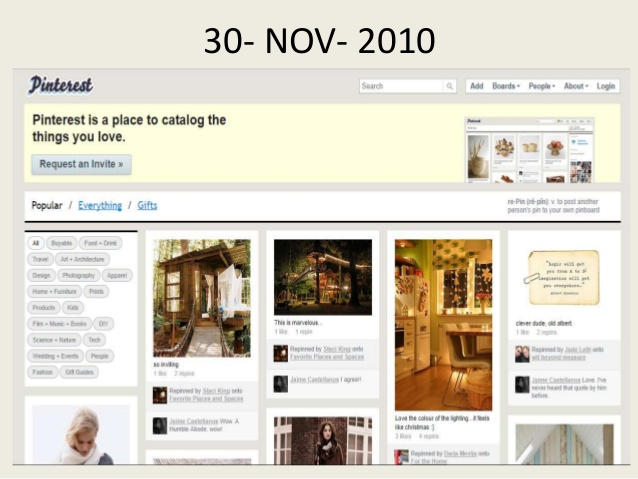

# Exercise #4: Mood Board
10 points

**DUE: Friday, October 30 by 5:00pm**

### Instructions

For this exercise, we'll put together all the techniques we covered this week to
make an interactive web page to build a collection of images related to a
theme—a [mood board](https://en.wikipedia.org/wiki/Mood_board).

Update `index.html` so that users start with an empty board and a prompt to 
enter a search query. Update `mood.js` to use an image search API to fetch 
images matching that  query and present them to the user. Using the same API 
or a different one, fetch additional suggested search terms based on the 
user's submission. Let users select images from the result set to be placed on 
their board (by adding them to the DOM). Keep those images on the board and 
allow users to keep running searches and adding more images.

You will need to find suitable APIs to use and create your own credentials. 
Save your API keys and any other required account information in a file called 
`apikey.js`. You'll notice that `apikey.js` is in the `.gitignore` file; 
**please do not check API keys into GitHub**. Even if it's not found by bots 
run by malicious users, it will likely be found by automated scanners and 
deactivated, breaking your code.

### Suggested APIs
You're free to choose any APIs you like, but students in past quarters have had
good luck with these two. Both work from the browser with `XMLHttpRequest`
without running into CORS problems.

**Image search: [Pixabay](https://pixabay.com/api/docs/)** is free but requires
an API key. Create an account at https://pixabay.com/accounts/register/, then go
to https://pixabay.com/service/about/api/, click **View API Documentation**, and
scroll down; once you're logged in, your key appears in the description of the
`key` parameter. Requests go to the Images endpoint, `https://pixabay.com/api/`,
with your key and query as parameters:

```
https://pixabay.com/api/?key=YOUR_API_KEY&q=SEARCH_TERM&image_type=photo
```

The image results are in the `hits` array of the response. The documentation
describes the fields each hit contains, including several image URLs at
different sizes. The free tier allows 100 requests per minute.

**Search suggestions: [Datamuse](https://www.datamuse.com/api/)** is free and
needs no key. A request like this one returns words related to the query (`ml`
stands for "means like"):

```
https://api.datamuse.com/words?ml=SEARCH_TERM
```

The response is an array of suggestion objects.

For either API, open a GET request to the URL with `XMLHttpRequest`, set its
`responseType` to `"json"`, and attach a `load` handler before sending it. In
the handler, iterate over the results (Pixabay's `hits`, or Datamuse's array) to
build your DOM elements. Remember to encode the user's query with
`encodeURIComponent()` before putting it into a URL.

Use your browser's developer tools to examine the response you get back from the
API and figure out which fields you want to use.
In your search results you'll also find a list of related search terms. Display
those to the user and make them clickable, such that clicking them runs a new
search with the suggested term as the query.
Don't worry about saving mood boards once they've been created. For this week we
will embrace ephemerality.

Remember to include in your submission any classmates you collaborated with and
any materials you consulted.

### Rubric
- Use `XMLHTTPRequest` to make an AJAX requests to an image search API (1 point)
- Use `XMLHTTPRequest` to make an AJAX requests to a suggested searches API  (1 point)
- Put your api credentials in `apikey.js`. Do not check them into GitHub, but *do* paste them into your submission on Canvas (1 point)
- Running a search clears previous search results (1 point)
- Use the DOM API to display image results to the user (2 points)
- Use the DOM API to display related concept results to the user (1 point)
- Clicking on a result image adds it to the user's mood board (2 points)
- Clicking on a related concept runs a new search for that concept (1 point)
