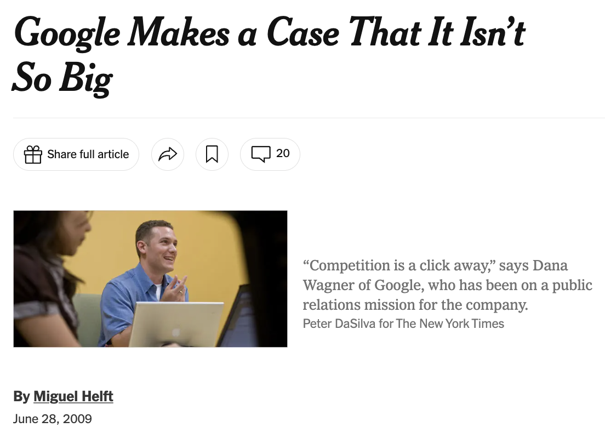
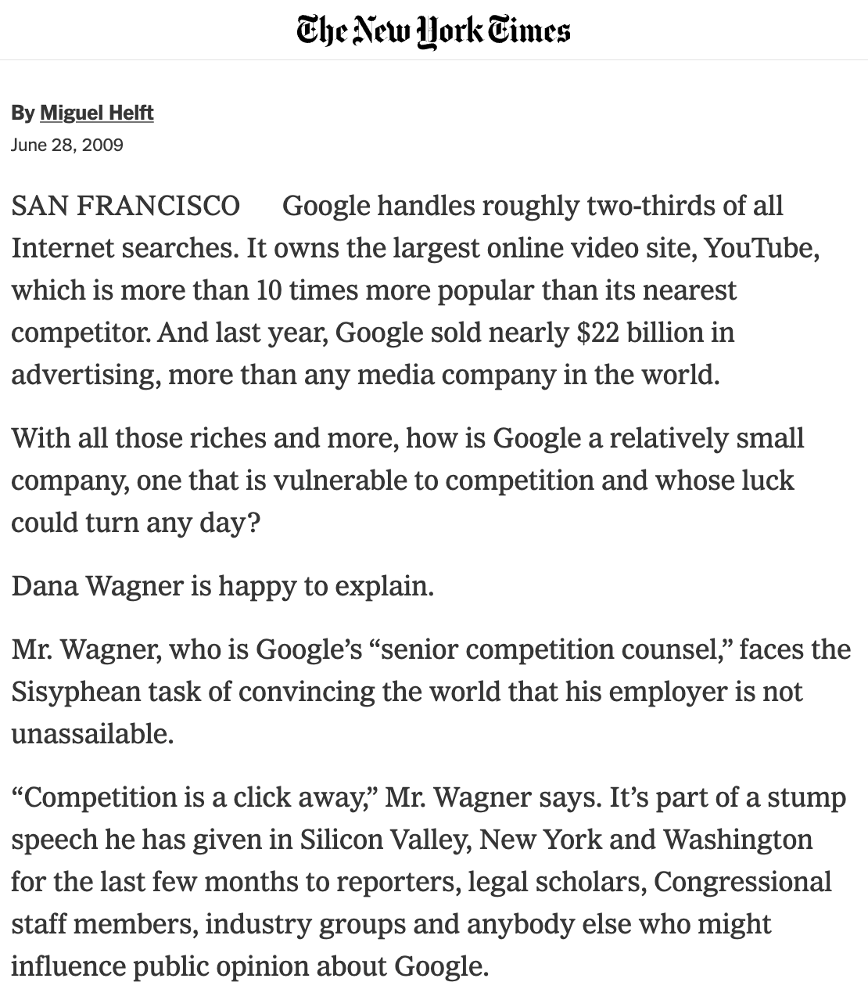

# MPCS 52553: Web Development
## Week 4: Javascript and REST APIs
---

class: agenda
# Why We Javascript

# Classical Javascript
- `<script>` tags
- `console.log`, `alert`, event handlers

# DOM Manipulation
- selectors, modifying attributes
- adding and removing nodes

# ES6
- "wats"
- `const` and `let`

# AJAX and REST APIs
---

# Why We Javascript
## "Competition is a click away."
[Google Response to Antitrust Concerns, 2009 (NYT)](https://www.nytimes.com/2009/06/29/technology/companies/29google.html)




---

# Why We Javascript
> The basic advice regarding response times has been about the same for [fifty]
years
<footer><cite>Miller 1968; Card et al. 1991<cite></footer>

.big[**0.1 second**] is about the limit for having the user feel that the system is
**reacting instantaneously**, meaning that no special feedback is necessary
except to display the result.

.big[**1.0 second**] is about the limit for the **user's flow of thought** to stay
uninterrupted, even though the user will notice the delay. Normally, no special
feedback is necessary during delays of more than 0.1 but less than 1.0 second,
but the user does lose the feeling of operating directly on the data.

.big[**10 seconds**] is about the limit for **keeping the user's attention** focused
on the dialogue. For longer delays, users will want to perform other tasks while
waiting for the computer to finish, so they should be given feedback indicating
when the computer expects to be done. Feedback during the delay is especially
important if the response time is likely to be highly variable, since users will
then not know what to expect.

[Response Times: The 3 Important Limits (Nielsen Norman Group)](https://www.nngroup.com/articles/response-times-3-important-limits/)
---

# Why We Javascript
###It is very hard to get HTTP responses back in less than 100 ms.
So if you're doing everything right, you get 1 request that you can send out and
back without interrupting the user's flow. And if you have to reload the whole
page, with all its HTML, CSS, and images, forget about it. You'll easily be
spending hundreds or thousands of milliseconds.
---

# Why We Javascript
> Netscape quickly realized that the Web needed to become more dynamic. Even if
you simply wanted to check that users entered correct values in a form, you
needed to send the data to the server in order to give feedback.

Speaking JavaScript *O'Reilly Media*, [https://exploringjs.com/es5/ch04.html](https://exploringjs.com/es5/ch04.html)
---

# Classical Javascript
## [Script Elements](https://developer.mozilla.org/en-US/docs/Web/HTML/Element/script#Examples)
- External file or inline
- Can go in head or body
- Evaluated immediately
- Global scope
---

# Classical Javascript

## [HTML Event Handlers](https://developer.mozilla.org/en-US/docs/Web/Guide/Events/Event_handlers#HTML_onevent_attributes)
- onclick
- onkeypress
- onfocus

## Examples
- [Alert Example](https://uchicagowebdev.github.io/course_materials/examples/week_4/alert)
- [Console Log Example](https://uchicagowebdev.github.io/course_materials/examples/week_4/console)
---

# Lab 4-1: Logging events to the Console

https://github.com/UChicagoWebDev/course_materials/tree/main/assignments/lab-4

```
<script>
var i =0;
function increment() {
  i = i+1;
  console.log(i);
}
</script>
```
---

# DOM Manipulation
### [DOM Element API](https://developer.mozilla.org/en-US/docs/Web/API/Element)
- [querySelector](https://developer.mozilla.org/en-US/docs/Web/API/Element/querySelector)
- [addEventListener](https://developer.mozilla.org/en-US/docs/Web/API/EventTarget/addEventListener)
- [setAttribute](https://developer.mozilla.org/en-US/docs/Web/API/Element/setAttribute)
---

# Lab 4-2: Buttons to change the styling of a `<div>`

https://github.com/UChicagoWebDev/course_materials/tree/main/assignments/lab-4

```
<div id="testing_ground">Watch me change colors!</div>
<input type="button" onclick="recolor('testing_ground')" value="Colorize!"></input>
<script>
function recolor(id) {
  var e = document.body.querySelector("#"+id);
  e.setAttribute("style","color: red");
}
</script>
```
---

# DOM Manipulation
### [DOM Element API](https://developer.mozilla.org/en-US/docs/Web/API/Element)
- [children](https://developer.mozilla.org/en-US/docs/Web/API/ParentNode/children)
  - [prepend](https://developer.mozilla.org/en-US/docs/Web/API/ParentNode/prepend)
  - [append](https://developer.mozilla.org/en-US/docs/Web/API/ParentNode/append)
  - [replaceWith](https://developer.mozilla.org/en-US/docs/Web/API/ChildNode/replaceWith)
- [cloneNode](https://developer.mozilla.org/en-US/docs/Web/API/Node/cloneNode)
- [document.createElement](https://developer.mozilla.org/en-US/docs/Web/API/Document/createElement)
---

# Lab 4-3: Buttons to Add New Page Elements 

https://github.com/UChicagoWebDev/course_materials/tree/main/assignments/lab-4

---

# ES6
### [Wat - A lightning talk by Gary Bernhardt from CodeMash 2012](https://www.destroyallsoftware.com/talks/wat)
(start at 1:20)
### [The WATs of Javascript](https://loomcom.com/blog/0097_the_wats_of_javascript.html)
Good explanation why the above weird behaviors happen.
### [Javascript Quirks and Elegant Features](http://speakingjs.com/es5/ch03.html)
---

# ES6
### ECMAScript Versions
1. June 1997
2. June 1998
3. December 1999
4. *Abandoned*
5. December **2009**
6. June **2015**
[ECMAScript Versions (Wikipedia)](https://en.wikipedia.org/wiki/ECMAScript#Versions)
---

# ES6 New Features
- [`let` and `const`](https://hacks.mozilla.org/2015/07/es6-in-depth-let-and-const/)
- [arrow functions](https://hacks.mozilla.org/2015/06/es6-in-depth-arrow-functions/)
- New methods on [Arrays](https://developer.mozilla.org/en-US/docs/Web/JavaScript/Reference/Global_Objects/Array)
- [Sets](https://developer.mozilla.org/en-US/docs/Web/JavaScript/Reference/Global_Objects/Set)
- Promises (for next week)
---

# ES6 New Features: `const`
The `const` keyword creates a read-only reference to a value. 
It does not mean the value it holds is immutable, 
just that the variable identifier cannot be reassigned.

```
var x = 1;
const y = 2;
const z = {a: 1, b: 2};
...
x=0;  // ok
y=4;  // error
z.a = 3;  // ok
```
---

# ES6 New Features: `let`
The `let` keyword declares a block-scoped local variable, 
instead of a global variable (like `var`).

```
for (var i = 0; i < 3; i++) setTimeout(() => console.log(i), 0);  // 3 3 3
for (let i = 0; i < 3; i++) setTimeout(() => console.log(i), 0);  // 0 1 2
```
---

# ES6 New Features: Arrow Functions
Arrow functions are a more concise syntax for writing function expressions.

```
let sum = function(x, y) { return x + y; };
let add = (x, y) => x + y;

sum(1, 2);  // 3
add(1, 2);  // 3
```
---

# ES6 New Features: Arrow Functions
Arrow functions do not have their own `this` context,
so they are useful for callbacks and event handlers.

```
class Timer {
  constructor() { this.seconds = 0; }
  start() {
    setInterval(function () { this.seconds++; }, 1000); // 'this' is not the Timer: NaN or a TypeError
    setInterval(() => { this.seconds++; }, 1000);        // works
  }
}
```
---

# ES6 New Features: Array Methods
- [forEach](https://developer.mozilla.org/en-US/docs/Web/JavaScript/Reference/Global_Objects/Array/forEach)
- [map](https://developer.mozilla.org/en-US/docs/Web/JavaScript/Reference/Global_Objects/Array/map)
- [filter](https://developer.mozilla.org/en-US/docs/Web/JavaScript/Reference/Global_Objects/Array/filter)
- [reduce](https://developer.mozilla.org/en-US/docs/Web/JavaScript/Reference/Global_Objects/Array/reduce)
- [find](https://developer.mozilla.org/en-US/docs/Web/JavaScript/Reference/Global_Objects/Array/find)
- [findIndex](https://developer.mozilla.org/en-US/docs/Web/JavaScript/Reference/Global_Objects/Array/findIndex)
- [some](https://developer.mozilla.org/en-US/docs/Web/JavaScript/Reference/Global_Objects/Array/some)
- [every](https://developer.mozilla.org/en-US/docs/Web/JavaScript/Reference/Global_Objects/Array/every)
- [includes](https://developer.mozilla.org/en-US/docs/Web/JavaScript/Reference/Global_Objects/Array/includes)
- [sort](https://developer.mozilla.org/en-US/docs/Web/JavaScript/Reference/Global_Objects/Array/sort)
- [reverse](https://developer.mozilla.org/en-US/docs/Web/JavaScript/Reference/Global_Objects/Array/reverse)
---

# ES6 New Features: Sets
A `Set` is a collection of unique values. 
Javascript will automatically remove duplicates when you add them to a `Set`.

```
let s = new Set();
s.add(1);
s.add(1);
s.add(2);
console.log(s);  // Set { 1, 2 }
```
---

# AJAX and REST APIs
### [Using XMLHttpRequest](https://developer.mozilla.org/en-US/docs/Web/API/XMLHttpRequest/Using_XMLHttpRequest)
### [JSON](https://developer.mozilla.org/en-US/docs/Learn/JavaScript/Objects/JSON)

Think of a Request as an object you are building, like a little boat or a wind-up toy. 
You can set its properties, like the URL and the HTTP method, 
and then you can send it off to the server. 
When the server responds, you can handle the response in a callback function.

```
function reqListener() {
  console.log(this.responseText);
}

const req = new XMLHttpRequest();
req.addEventListener("load", reqListener);
req.open("GET", "http://www.example.org/example.txt");
req.send();
```
---

# Exercise 4

[Exercise 4 on Canvas](https://canvas.uchicago.edu/courses/75391/assignments/923310)

[Exercise 4 on GitHub](https://github.com/UChicagoWebDev/course_materials/tree/main/assignments/exercise-4)
